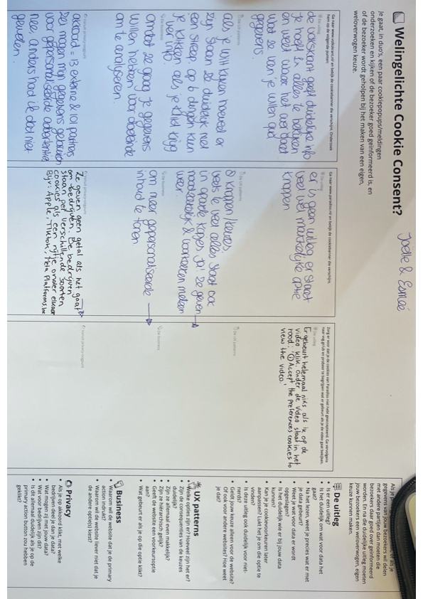

# Model

Het staat model voor digitale tuintjes welke bij 'Het web is voor iedereen' door studenten worden gemaakt.

### 31 aug - Kickoff

 
Lees meer

Ik heb een fork van de model repository gemaakt en gepubliceerd via mijn eigen Github omgeving.

## Check-out (Met Christina)
De checkout vragen voor vandaag:
1. Leg uit wat een source hosting platform is en voor welke jij gekozen hebt:  
Een source hosting platform (broncodehostingsplatform) is een online platform waar ontwikkelaars de broncode van hun software opslaan, beheren en samen bewerken via versiebeheersystemen. Wij hadden keuze tussen Github en Codeberg, maar ik had vernomen dat Github makkelijker is en ik had daar al een account van dus ik heb gekozen voor Github.

2. Vertel welke domeinnaam jij gekozen hebt en hoe je die hebt gekoppeld aan jouw pagina:
Ik heb gekozen voor de domeinnaam Createmyidea.nl en ik heb dat gekoppeld door op Transit.nl mijn GitHub account te koppelen door het in te vullen bij 'waarde', daarna heb ik mijn domeinnaam ingevuld op GitHub.
   
3. Beschrijf hoe je aanpassingen aan jouw pagina kunt maken en hoe je er voor zorgt dat die op het web gepubliceerd worden:
Moet ik nog uitzoeken want ik heb nog geen aanpassingen aan mijn pagina gemaakt.

### 3 sept - [Workshop] 

 
Lees meer

Ik heb 2 workshops gevolgd deze dag. Een over schetsen van Charley. We hebben geoefend met het maken van rechte lijnen en vierkanten.
We moesten een website opzoeken en natekenen. Dit is zalando.  
  

   
Bij Diederik heb ik een workshop gevolgd over typografie. De workshop begon met de geschiedenis van typografie en daarna hebben we aan de hand van twee foto's van dolly Parton, lettertypes gezocht die bij haar passen. Dit deden we door woorden op te schrijven die passen bij de foto's en daarna woorden op te schrijven die passen bij die woorden.

### Sprint 1 maandag 7 september

 
Lees meer

We hebben in groepjes artikelen gelezen en daarna klassikaal besproken.
Ik heb 'A Brief History & Ethos of the Digital Garden' gelezen en daarna een korte samenvatting gemaakt zonder weer in het artikel te kijken tijdens het maken van de samenvatting.:

Een digital garden is een plek op het web waar er veel ruimte is voor groei. Er wordt niet zo zeer gelet op wanneer iets is gepubliceerd als het wordt aanbevolen, er wordt meer gelet op de inhoud. Je ziet naast de datum dat het is gepubliceerd ook de datum waar er het laast aan is gewerkt. 
Een digital garden is een persoonlijke plek waar je alles zo persoonlijk en gek kan maken als je wil en deze is nooit klaar met groeien.

In groepjes hebben we websites bekeken en beoordeeld hoe 'webby' ze zijn. Wij hebben een formulier met criteria ingevuld. Daarna hebben we als groep de websites besproken en bepaald welke van deze websites het meest en minst webby is. Daar kwam uit:
  
-meest webby: Ericwbailey.website    
 
  -minst webby: Virtualvampirehaven.neocities.org    
Ik ga nu verder met het huiswerk.
Dit betekent dat ik kijk naar welk onderwerp ik wil gebruiken voor mijn website en hoe ik wil dat het er ongeveer uit gaat zien.

**Check-out**
1. Leg uit wat een digital garden is en waarom dat anders is dan een reguliere website:  
Een digital garden is een plek op het web waar er veel ruimte is voor groei. Er wordt niet zo zeer gelet op wanneer iets is gepubliceerd als het wordt aanbevolen, er wordt meer gelet op de inhoud. Je ziet naast de datum dat het is gepubliceerd ook de datum waar er het laast aan is gewerkt. 
Een digital garden is een persoonlijke plek waar je alles zo persoonlijk en gek kan maken als je wil en deze is nooit klaar met groeien.
   
2. Leg uit wat een website 'webby' maakt en welke websites jou het meeste inspireren:  
Een website is webby als het fluïde, interactief, toegankelijk, volwassen, expressief en leuk/verassend is. Ik weet nu niet uit mijn hoofd welke websites me inspireren.
   

4. Vertel waar jij mee aan de slag wilt gaan bij het maken van jouw eigen digital garden (let op: dit zijn jouw eerste ideeën, dit kan en mag veranderen in de loop van het programma:   Ik wil in mijn website gebruik maken van animaties en ik vind een focus-state en hover state ook erg belangrijk.

### Sprint 1 woensdag 9 sept 

 
Lees meer

Wij hadden online les vanwege stakingen.
We hebben kort in duo's gepresenteerd
Ik heb van Esmee en Eva gehoord waar ze het over willen hebben.
Daarna hebben we inspo gezocht voor lettertypes. Ik heb posterss verzameld die er wel interessant uitzagen en ik heb geschetst.

We begonnen met sfeerwoorden bedenken. Ik had: "Ik voel me creatief, fantasierijk, magisch."
Daarna hebben we afbeeldingen verzameld die passen bij deze sfeerwoorden. We hebben dus visueel beeld gezocht. Daarna hebben we nog een abstracte visuele vertaling gemaakt. Daarvoor hebben we gekeken naar fonts op posters. ALs laatste hebben we nog opgeschreven waarom deze posters passen bij de sfeer.
Link naar miro: https://miro.com/app/board/uXjVHq1zApo=/?share_link_id=829585340391  
 

## Check out: Mijn garden gaat over mijn creaties, en ik wil het een prinsessenachtige of sprookjesachtige sfeer geven.

### Vrijdag 11 sept

 
Lees meer

Vandaag hebben we aan de hand van schetsen een begin gemaakt aan html. Hier had ik de schetsen nog niet als code. Ik had alleen een nav balk gemaakt in html css door een afbeelding te maken in illustrator en die steeds te herhalen. Dit is image repeat  

  

 
### Maandag 14 sept

 
Lees meer

Als huiswerk heb ik veel gewerkt in illustrator en photoshop aangezien we alleen eigen content mogen gebruiken. Daarna heb ik deze ook aangepast om extra afbeeldingen te krijgen voor dark mode.  

   
Vandaag was de bi-weekly geek 1. 
  
We hebben onderzoeksvragen bedacht in groepen van 4. Daarna hebben we ons blad met vragen doorgegeven en onderzoekmethodes gekoppeld aan de vragen van een ander groepje.

Check out met Ella:
Wanneer is een website lelijk?
Ik vind een website lelijk als content niet op schaal is. Als het te groot of te klein is.

De volgende stappen om mijn website responsive te maken zijn de afbeeldingen op een breed scherm naast elkaar te plaatsen en op een kleiner scherm onder elkaar.

Ik kan de bouw van mijn digital garden misschien wel uitleggen in 'Webby vocabulaire.'

Ik heb thuis ook afbeeldingen ontworpen in illustrator:   

### Vrijdag 18 sept

 
Lees meer

Vandaag hebben we voortgangsgesprekken gevoerd en hebben we de retrospect gedaan.
Ik heb met mn groep bepaald waar een goede tekening aan moet voldoen. Hieronder:   

    
## Checkout:
Vragen en termen 
1. Waarom geven de docenten deze opdracht?  
De docenten geven deze opdracht zodat we als ontwerpers weten wat er mogelijk is qua code. Het is ook handig als we met andere ontwerpers willen samenwerken.   
2. Welke technieken gebruik ik? 
en van de belangrijkste leerdoelen van dit blok is het leren van HTML en CSS zodat je een betere digitale ontwerper wordt. Je kan er vanuit gaan dat HTML en CSS een belangrijke rol spelen in de opdracht.    
3. Wat zijn de randvoorwaarden?  
Naast de gebruikte techniek zijn er eigenlijk altijd ook andere randvoorwaarden. Zorg er voor dat je die goed voor ogen hebt. Bijvoorbeeld: hoe veel tijd heb je? Wat is je kennis tot nu toe? Maar ook: is mijn ontwerp wel toegankelijk? voldoet het aan de privacy-wetgeving? En ook: is mijn ontwerp wel echt webby of maak ik een plaatje van een website?   
4. Waar gebruik je HTML/CSS voor?  
Wees je bewust van de mogelijkheden en de onmogelijkheden van HTML en CSS. HTML is om content te structureren en om interactie mogelijk te maken. CSS is om vorm te geven, om dingen te verduidelijken, en om interactie prettiger te maken.   
5. Wat kan er allemaal met CSS?  
Niemand weet wat er allemaal kan met CSS, er kan zoveel, steeds meer, en nog niet alles is ontdekt. Maar je kan wel een heel goed beeld krijgen van wat er allemaal ongeveer kan. Je kan op allerlei manieren dingen layouten, je kan eindeloze hoeveelheden visuele effecten toepassen, en je kan op talloze manieren dingen laten animeren. Je hoeft natuurlijk niet alles te kunnen, daar is dit blok veel te kort voor, maar het is wel lang genoeg om te zien wat er allemaal kan. Dan kan je kiezen wat je wil gaan leren, zowel tijdens het blok als daarna. 

### Sprint 2 maandag 21 sept.

 
Lees meer

Vandaag hebben we gekeken naar bestaande cookie pop ups van website's. Bijvoorbeeld van de volkskrant.  
   Weet jij waarmee je precies akkoord gaat als je op “accepteren” klikt?  

Om deze vraag te beantwoorden ga je drie verschillende cookiemeldingen onderzoeken. Een cookiepopup van de Volkskrant, en twee hele verschillende van Paradiso.
  
Na het bekijken van de websites hebben we een formulier ingevuld. en we hebben uitleg gekregen over de html structuur. De docent was aan het coderen en we keken mee.  

## Check-out
1.Wat zijn HTML landmark role elements?  
HTML landmark role elements zijn elementen die de belangrijkste onderdelen van een webpagina aangeven. Ze helpen bezoekers en screenreadergebruikers om snel door een website te navigeren. Voorbeelden zijn `<header>`, `<nav>`, `<main>`, `<aside>` en `<footer>`. Je kunt hiermee de structuur van een pagina duidelijk maken.    
2.Wat zijn heading elementen en hoe horen deze 'genest' te worden?  
Heading elementen zijn koppen die de structuur en hiërarchie van een webpagina aangeven. Ze lopen van `<h1>` tot en met `<h6>`, waarbij `<h1>` de belangrijkste kop is en `<h6>` de minst belangrijke. Je hoort ze in een logische volgorde te gebruiken, waarbij je de structuur van de inhoud volgt. Bijvoorbeeld: een `<h1>` voor de paginatitel, `<h2>` voor de hoofdonderdelen en `<h3>` voor subonderdelen binnen een `<h2>`. Sla niet zomaar kopniveaus over, bijvoorbeeld van `<h2>` naar `<h4>`.    

3.Hoe ga jij met cookies om? Beschrijf jouw beweegredenen en of die zijn veranderd na het volgen van dit college.  
Ik accepteerde nooit functionele cookies en nu na deze las nog steeds niet

### Woensdag 23 sept

 
Lees meer

Ziek thuis dus achterstand opgelopen. Ik heb thuis niet gewerkt.

### Vrijdag 25 sept

 
Lees meer

ziek thuis dus achterstand opgelopen. Ik heb thuis niet gewerkt

### Maandag 28 sept:

 
Lees meer

Vandaag was Bi-weekly geek 2

-Wat bedoelt Vasilis met de uitspraak: Semantiek doet mij niet zo veel, ik ben liever bezig met de UX van HTML?
Hiermee bedoelt Vasilis dat hij minder waarde hecht aan de betekenis/structuur van HTML-elementen en vooral kijkt naar hoe HTML zich gedraagt en hoe prettig het voor de gebruiker werkt.

-Wat voor type beperkingen hebben invloed op het gebruiken van websites?
Visueel
Auditief
Motorisch
Cognitief

-Noem drie manieren om door een website te navigeren met jouw screenreader.
Er zijn shortcuts:
[control]+[option]+[U]	open lijst met headings, links, formelementen
↳ [←][→]	wissel tussen de lijsten
↳ [↓][↑]	op en neer in een lijst.

We hebben deze les gekeken naar hoe het is om een beperking te hebben. d.m.v brillen bijvoorbeeld waardoor je zicht minder goed is. of hoe het voelt om weinig controle te hebben in je handen en vingers. Ik vond dit wel interessant om te doen.

### Woensdag 30 sept:

 
Lees meer

ziek thuis

### Vrijdag 2 okt:

 
Lees meer

Vandaag hebben we voortgangsgesprekken.
Ik heb veel feedback gekregen om te verwerken. Dat kwam ook doordat ik ziek was. Daarom was ik nog niet zo ver als gehoopt. Ik moet nog veel veranderen aan de code. Ik ben wel bij dat ik deze feedback heb ontvangen.

    Ik wist hier nog niet welke informatie in mijn cookie pop up  Ik wist dat de website geen optionele cookies gebruikte. De cookie pop up was hier nog te lang en niet mooi vormgegeven. Inhoudelijk was het ook niet goed.

### maandag 5 okt Sprint 3:

 
Lees meer

We hebben schetsen gemaakt voor onze songteksten.  
Zijn begonnen aan eerste versie html  
een lied gekozen.Ik heb gekozen voor Freezing omdat het tempo van het lied me aansprak en ik vond dat deze het beste ij mijn website paste.  

---

 ## 1. Leg uit wat er met de volgende termen bedoeld wordt: kerning, tracking, leading, flush-left, flush-right, centered, justified, indent, outdent, modular scale, movable type, focus punt, vijf soorten contrast, spatial tension.    

- **Kerning:** De ruimte tussen twee specifieke letters. Je kunt deze aanpassen zodat letters er optisch goed uitzien, bijvoorbeeld bij de combinatie A en V. 
- **Tracking:** De ruimte tussen alle letters in een woord of tekst. Je kunt letters dichter bij elkaar zetten of juist meer ruimte geven.  
- **Leading:** De verticale afstand tussen tekstregels. Goede regelafstand maakt een tekst prettiger leesbaar.  
- **Flush-left:** Tekst die links uitgelijnd is. De linkerkant is recht en de rechterkant is ongelijk.  
- **Flush-right:** Tekst die rechts uitgelijnd is. De rechterkant is recht en de linkerkant is ongelijk.  
- **Centered:** Tekst die gecentreerd is. De tekst staat rondom een denkbeeldige verticale middenlijn.  
- **Justified:** Tekst die zowel links als rechts uitgelijnd is. De ruimte tussen woorden wordt aangepast om beide kanten recht te maken.  
- **Indent:** Een inspringing waarbij een regel of alinea naar rechts wordt verplaatst.  
- **Outdent:** Het tegenovergestelde van indent. De tekst steekt naar links uit buiten de normale uitlijning.  
- **Modular scale:** Een systeem waarbij verschillende tekstgroottes gebaseerd zijn op een vaste verhouding. Hierdoor ontstaat een samenhangende typografische hiërarchie.  
- **Movable type:** Een druktechniek waarbij losse, herbruikbare letters en tekens worden gerangschikt om teksten af te drukken.  
- **Focus point:** Het punt in een ontwerp dat als eerste de aandacht trekt. Dit kan bijvoorbeeld een opvallende afbeelding, grote titel of contrasterende kleur zijn.    
- **Vijf soorten contrast:**  
  1. **Grootte:** grote en kleine elementen. 
  2. **Kleur:** verschillende kleuren of licht-donkerwaarden.  
  3. **Gewicht:** dunne en dikke letters.  
  4. **Vorm:** bijvoorbeeld ronde en hoekige vormen.  
  5. **Ruimte:** elementen die dicht bij elkaar staan tegenover elementen met veel ruimte eromheen.  
- **Spatial tension:** Ruimtelijke spanning die ontstaat door de plaatsing en afstand tussen elementen. Door bijvoorbeeld tekst dicht bij de rand te zetten of elementen asymmetrisch te plaatsen, kan een ontwerp spannend en dynamisch worden.    

## 2. Wat is jouw ideale regellengte (measure)? Leg uit waarom.  

Mijn ideale regellengte is ongeveer 50 tot 75 tekens per regel. Dit vind ik prettig lezen, omdat mijn ogen niet te ver hoeven te bewegen van links naar rechts. Als regels te lang zijn, is het moeilijker om de volgende regel terug te vinden. Als ze te kort zijn, moet je juist heel vaak naar een nieuwe regel springen. De ideale lengte hangt ook af van het lettertype en de lettergrootte.    

## 3. Als je in een ontwerp maar één variabele tot je beschikking had om hiërarchie aan te brengen (grootte, plaatsing, spacing, lettersoorten), welke zou je dan gebruiken en waarom?  

Ik zou kiezen voor grootte. Door belangrijke tekst groter te maken dan minder belangrijke tekst, kan ik duidelijk aangeven waar de bezoeker als eerste naar moet kijken. Zo kan ik onderscheid maken tussen titels, tussenkoppen en gewone tekst, zonder dat ik verschillende lettertypes of kleuren nodig heb. Dit maakt het ontwerp overzichtelijk en zorgt ervoor dat de belangrijkste informatie direct opvalt.    

### Woensdag 7 okt:

 
Lees meer

Vandaag zijn we verder gegaan met onze schetsen. We hebben gewerkt in html css. 

Check-out:

-Waarom is het goed om een grid in je ontwerp toe te passen? 
Noem een reden voor de ontwerper en een voor de bezoeker. 
Voor de ontwerper: Met grid kan je makkelijk dingen positioneren en per onderdeel aanpassen.
Voor de bezoeker: Door een grid is de website overzichtelijk. Als een website overzichtelijk is dan is het voor een bezoeker fijn om een website te gebruiken.

-Noem drie manieren om chaos in je ontwerp te voorkomen.  
Let op de hierachie. Niet alles moet even erg opvallen. De dingen die bijvoorbeeld duiddelijk moeten uitspringen kan je bijvoorbeeld groter maken.

-Hoeveel gekkigheid moet er in je werk zitten?  
Dat kan je zelf bepalen. Het hangt er ook vanaf wat het doel van je ontwerp is. In dit geval moet de hierarchie duidelijk zijn dus de gekkigheid moet de hierarchie niet negatief beinvloeden. Dat kan gebeuren als er heel veel gekkigheid is.

### Vrijdag 9 okt:

 
Lees meer

 Vandaag hebben we onze website's klasikaal gepresenteerd. Het plan was om dit in duo's te doen, maar er waren maar 7 mensen aanwegzig, dus we hebben het klasikaal gedaan en feedback gekregen.
 Daarna heeft een student mij goed geholpen met het positioneren van mijn lyrics dmv grid.  

  
Mijn feedback:

Songtekst:
- Goed gebruik gemaakt van groottes 
- Voor wat het nu is, ookal is het niet af, al heel mooi opgemaakt en goed gebruik van witruimtes
- Ontwerp ook wat er gebeurd op verschillende dimensies, dus stel je hebt een kleiner scherm
- Gebruik css om dingen dikgedrukt te maken ipv meerdere elementen in html
- Gebruik sections binnen een article in plaats van verschillende h's

Digital Garden:
- Minder verschillende lettertypes
- Ze waren heel erg impressed met je mooie kledingontwerpen :
- Over het algemeen ziet je site er echt super uitdagend
- Het is leuk hoe je in het begin bij je home scherm 'naar je kamer' ontwerpen

Na de les heb ik nog een paar uur in de media lounge aan mijn website gewerkt.
Ik heb de illustratie van mijn cookie pop up in light en dark mode gemaakt in illustrator, de afbeelding op de home page groter gemaakt en gekeken naar welke informatie in mijn cookie pop up moet.

### Maandag 12 okt:

 
Lees meer

vakantie

### Woensdag 14 okt:

 
Lees meer

vakantie

 
### Vrijdag 16 okt:

 
Lees meer

vakantie

 
### Maandag 19 okt:

 
Lees meer

We hebben gezamenlijk een paar artikelen gelezen over special tension en hoe je tekst kan positioneren.
Maandag heb ik na school nog een paar uur gewerkt aan mijn website. Ik heb in illustrator afbeeldingen gemaakt die ik heb gebruikt voor de light en dark mode van de cookie's

### Woensdag 21 okt:

 
Lees meer

We zijn de les begonnen met klasikaal naar elkaars werk kijken van de songteksten.
Daarna zijn we begonnen met de Bi-Weekly.
Dit ging over betrouwbare informatie op het internet.

We hebben zelf vragen bedacht die antwoord kunnen geven op de hoofdvraag met onderzoekmethodes.
Ik heb in illustrator de afbeelding voor de cookie knop gemaakt. Dit lijkt net op een prijskaartje van een kledingstuk,

Dit is mijn vernieuwde cookie pop up

 
### Donderdag 22 okt:

 
Lees meer

Ik heb de hele dag thuis gewerkt. ik heb de light dark mode knop toegevoegd op de home page. Meer animatie's toegevoegd, een cookie knop toegevoegd zodat de bezoeker terug kan naar de cookies informatie. Ook heb ik een laag met tekst toegevoeg bij mijn creaties als je eroverheen hovert. Dit was makkelijker dan ik had gedacht.

Ik heb ook mijn songtekst meer vormgegeven doormiddel van een glow effect en animatie. Als je over de woorden, name, books, family en history hovert dan worden de woorden duidelijk leesbaar. Ik heb gekozen voor een donkere achtergrondkleur en de 'if you had no' in wit. omdat ik dat een mooi contrast vind. Het is ook een koude kleur donkerblauw.       

Op deze screenshot kan je zien dat ik een donkere laag met tekst heb toegevoegd aan mijn foto's op de creaties pagina. Dit heb ik gedaan om meer informatie over mijn creaties te delen zonder dat de pagina nog veel langer word. Het is gelukt met tekst-overlay in html

### Vrijdag 23 okt:

 
Lees meer

Vandaag is het laatste feedback moment. Ik heb na de les met Christina nog een aantal dingen toegevoegd aan mijn website.
Bijvoorbeeld dit icoontje bovenaan

We hebben ook een animatie gemaakt voor de kroonluchter. Deze beweegt heel kort van links naar rechts als een bootje als iemand de pagina opent. Dit duurde lang en we hebben heel lang moeten denken over hoe de kroonluchter mooi kan bewegen.
Ook hebben we de glow van de kroonluchter omhoog gezet met top -em zodat het lijkt alsof het licht uit de kroonluchter komt als je op light mode bent. 
Ik heb ook een aparte afbeelding van de toverstaf cursor gemaakt voor als hover. Zo is het duidelijker waar je wel of niet op kan klikken.

### Zondag 25 okt:

 
Lees meer

Ik heb mijn Learning Log aangevuld en getest of alles lukt met tab en screenreader.

### Maandag 26 okt:

 
Lees meer

Vandaag is de expo. Ik schrijf dit nu maandagmiddag. De expo ging goed, we hebben van iedereen de website bekeken en stickers geplakt op de werkbladen van de personen die we erg goed vonden.

